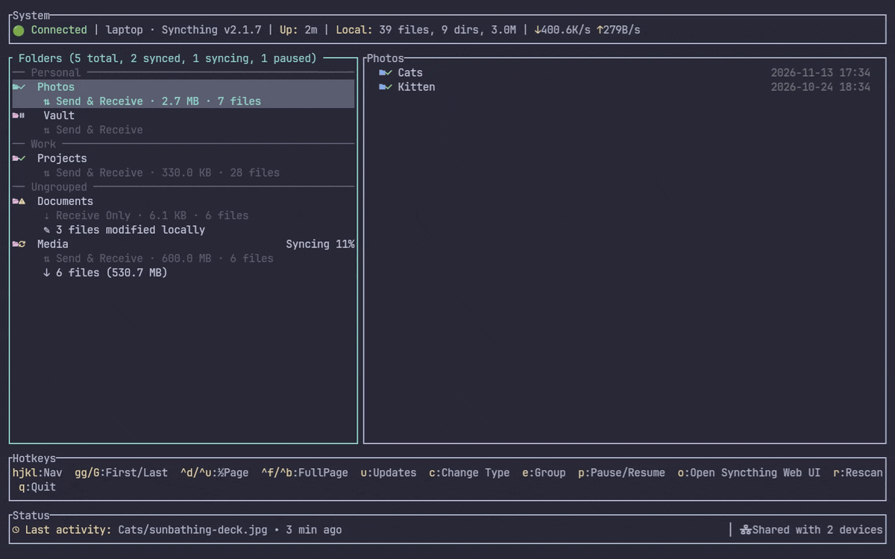
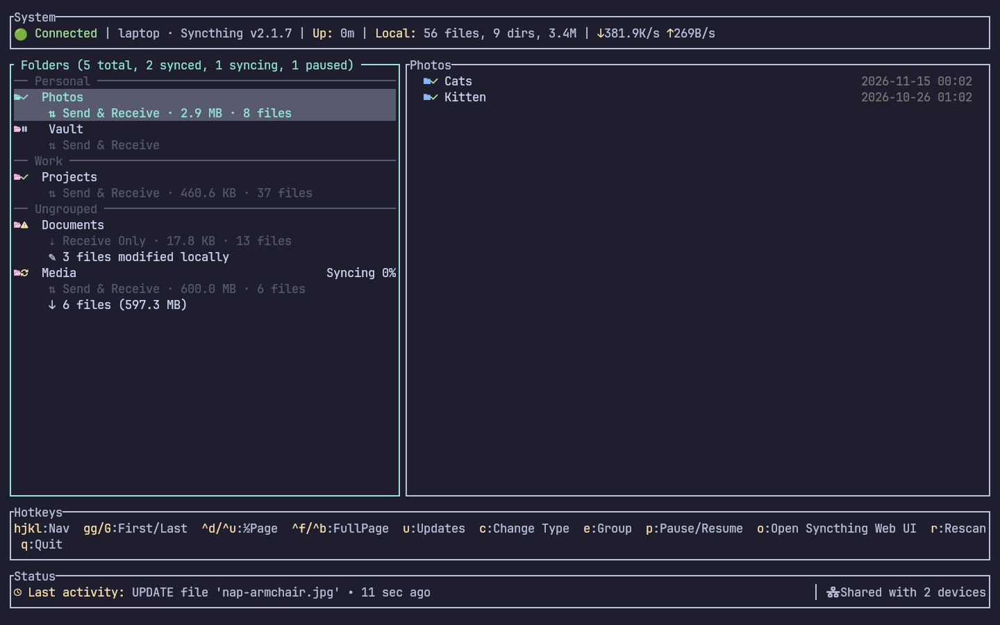
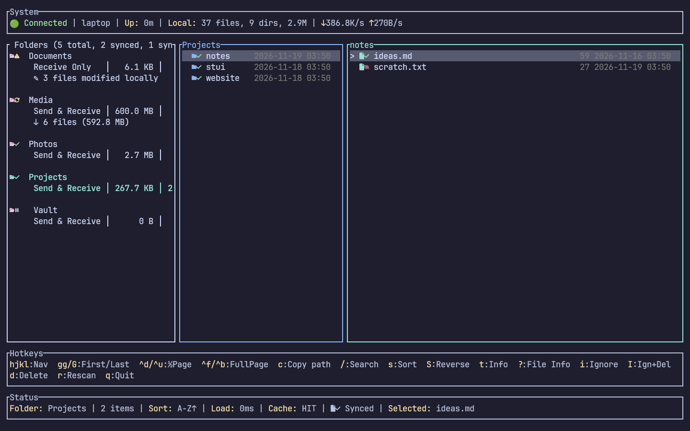
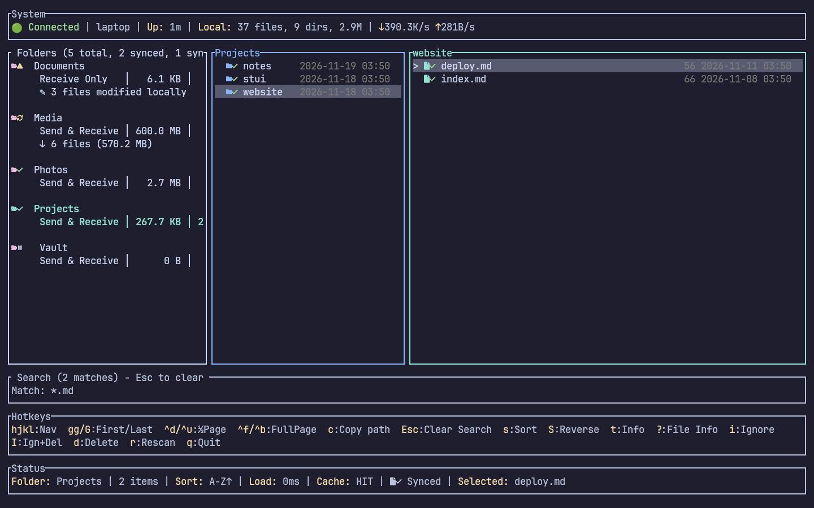
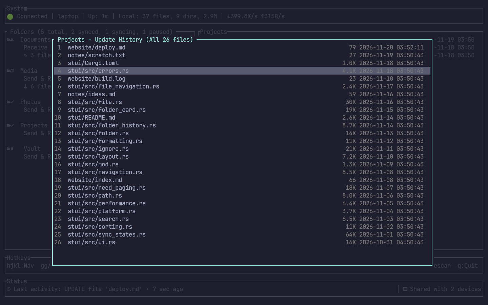
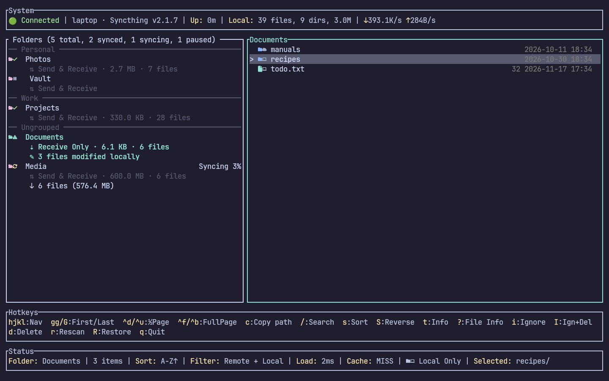
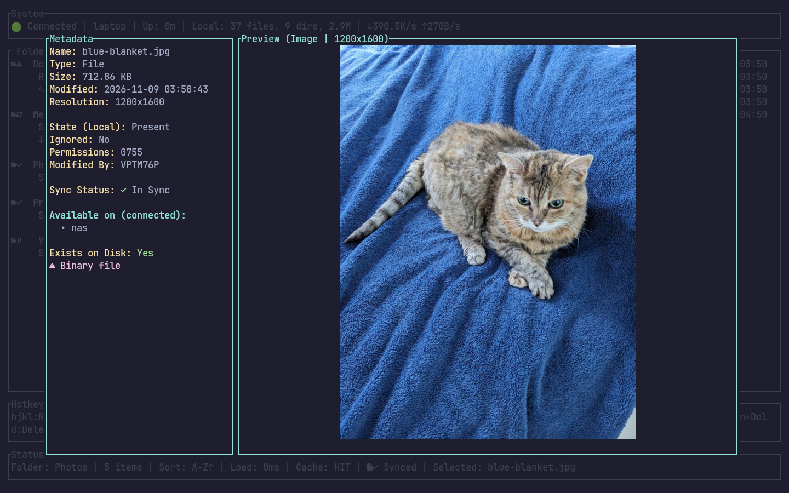
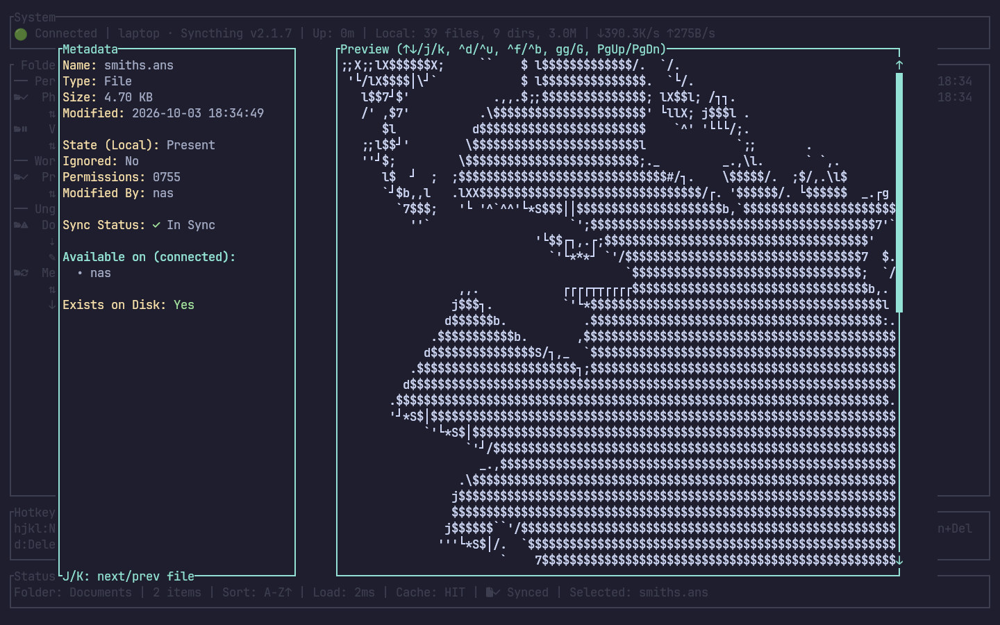

# Stui

A fast, keyboard-driven terminal UI for managing [Syncthing](https://syncthing.net/) — browse folders, track sync states, manage ignore patterns, and control your files, all from the comfort of your terminal.




## Screenshots

<table>
  <tr>
    <td width="50%"><br>Folders grouped by Syncthing folder group, with sync progress, paused folders, and local changes at a glance</td>
    <td width="50%"><br>Multi-pane navigation with sizes, timestamps, and ignore states</td>
  </tr>
  <tr>
    <td><br>Recursive wildcard search that follows you into subfolders</td>
    <td><br>Update history: press Enter to jump to the file</td>
  </tr>
  <tr>
    <td><br>Out-of-sync filter showing local changes in a receive-only folder</td>
    <td><br>Image preview using terminal graphics</td>
  </tr>
  <tr>
    <td><br>ANSI art preview with CP437 decoding</td>
    <td></td>
  </tr>
</table>

Screenshots and the demo GIF are generated by [`demo/record.sh`](demo/README.md) against throwaway Syncthing instances.

## Features

### 🚀 Real-Time Sync Monitoring
- **Live Status Updates**: See sync state changes instantly with visual icons (`📄✅` synced, `📁⛅` remote-only, `📄🔄` syncing)
- **Directory States Up Front**: Directories show remote-only files or local changes inside them as soon as a folder opens, without browsing into each one
- **Folder Cards**: State icon, type (`⇅` Send & Receive, `⇡` Send Only, `⇣` Receive Only), size, file count and what's left to sync, with words only where icons can't say it (`Syncing 62%`, scanning, errors). Cards drop detail instead of getting cut off as the folder pane narrows while you browse
- **Ignored File Detection**: Distinct icons for ignored files that exist (`📄🔇`) vs deleted (`📄🚫`)
- **Local Deletions**: Files deleted on this device in a Receive Only folder show `📄❌` and "Deleted locally". Press `u` to download one again from your other devices, or `R` to revert the whole folder
- **Icon Modes**: Choose between emoji or Nerd Fonts icons
- **System Dashboard**: View device name, Syncthing version, uptime, storage usage, and live transfer rates

### 📁 File & Folder Management
- **Breadcrumb Navigation**: Multi-pane directory browsing with ancestor highlighting
- **Recursive Search**: Fast wildcard search (`*jeff*`, `*.txt`) with instant filtering as you type
- **Out-of-Sync Filter**: Press `f` to show only files that need attention
  - Shows remote files you need to download
  - Shows local changes in receive-only folders (added/deleted/modified files)
  - Works recursively across entire folder hierarchy
  - Loads the full list in the background for large folders, with progress in the status bar
- **Update History**: View recent file changes with timestamps (lazy-loaded pagination) — press `Enter` to jump directly to any file's location
- **Flexible Sorting**: Sort by sync state, name, date, or size
- **File Preview Popup**: View file details, text content, ANSI art, or images directly in terminal
  - **Text files**: Scrollable with vim keybindings
  - **Markdown**: Rendered headings, lists, quotes, code blocks, links and tables; press `r` for the raw source
  - **Step through files**: `Shift+↑`/`Shift+↓` (or `K`/`J` in vim mode) preview the previous or next file without closing the popup
  - **ANSI art**: Auto-detection with CP437 encoding and 80-column wrapping
  - **Images**: Terminal graphics (Kitty/iTerm2/Sixel/Halfblocks protocols)
- **Ignore Management**: Add/remove files from `.stignore` patterns
- **Folder Control**: Pause/resume sync, change folder type (Send Only/Send & Receive/Receive Only)
- **Folder Groups** (Syncthing 2.1+): Folders are listed under their group, ungrouped last. Press `e` to move a folder into a group, take it out, or create a new group. On older Syncthing the list stays ungrouped and `e` tells you which version groups need
- **Safe Operations**: Confirmation prompts for delete, restore, and other destructive actions

### ⌨️ Keyboard-First Interface
- **Arrow Keys or Vim Mode**: Choose your preferred navigation style
- **Single-Key Actions**: Quick commands for all operations (sort, ignore, delete, search, etc.)
- **Context-Aware Help**: Smart hotkey legend shows only relevant keys for current view
- **Terminal Title**: The window or tab title shows where you are (`stui · Projects/website`) and is restored when you quit

## Installation

### From Source

```bash
git clone https://github.com/corcoran/stui.git
cd stui
cargo build --release
sudo cp target/release/stui /usr/local/bin/
```

Optional: build with `--features chafa` for much better image previews in terminals without a graphics protocol, rendered with [chafa](https://hpjansson.org/chafa/) instead of plain half-blocks. This links libchafa dynamically, so it must be installed (e.g. `pacman -S chafa`, `apt install libchafa-dev`) both when building and when running.

### Prerequisites
- Rust 1.70+ (install via [rustup](https://rustup.rs/))
- A running Syncthing instance (local or remote)

## Configuration

Create a config file at the platform-specific location:
- **Linux**: `~/.config/stui/config.yaml`
- **macOS**: `~/Library/Application Support/stui/config.yaml`
- **Windows**: `%APPDATA%\stui\config.yaml`

```yaml
api_key: "your-syncthing-api-key"
base_url: "http://127.0.0.1:8384"

# Optional: Icon display mode ("emoji" or "nerdfont")
icon_mode: "nerdfont"

# Optional: Command to open files/directories (e.g., xdg-open, code, vim)
# Linux: "xdg-open", macOS: "open", Windows: "explorer"
open_command: "xdg-open"

# Optional: Command to copy to clipboard (receives text via stdin)
# Wayland: "wl-copy", X11: "xclip" or "xsel", macOS: "pbcopy", Windows: "clip.exe"
clipboard_command: "wl-copy"

# Optional: Map container paths to host paths (for Docker setups)
path_map:
  "/data": "/home/user/syncthing-data"
  "/photos": "/mnt/photos"

# Optional: Enable vim keybindings by default
vim_mode: false

# Optional: Image preview settings
image_preview_enabled: true        # Enable/disable image preview (default: true)
image_protocol: "auto"             # auto|kitty|iterm2|sixel|halfblocks (default: "auto")

# Optional: Show the current folder, path or file in the terminal title (default: true)
terminal_title: true
```

`auto` asks the terminal what it supports and uses Kitty graphics in Konsole and kitty. Terminals without a graphics protocol fall back to half-blocks, or chafa when built with `--features chafa`.

### Finding Your Syncthing API Key

1. Open Syncthing Web UI (usually http://127.0.0.1:8384)
2. Go to **Actions** → **Settings** → **General**
3. Copy the **API Key** value

### Docker Setup Example

If Syncthing runs in Docker with volume mounts, configure `path_map` to translate paths:

```yaml
path_map:
  "/data": "/home/user/Sync"        # Container path → Host path
  "/media": "/mnt/external/media"   # Multiple mappings supported
```

This allows stui (running on host) to perform file operations on the correct paths.

## Usage

### Basic Commands

```bash
# Start stui (reads config from ~/.config/stui/config.yaml)
stui

# Enable vim keybindings for this session
stui --vim

# Enable debug logging
stui --debug
```

### Navigation Keys

**Standard Navigation:**
- `↑` / `↓` — Navigate items
- `Enter` / `→` — Preview file (if file) or enter directory (if folder)
- `←` / `Backspace` — Go back to parent directory
- `PageUp` / `PageDown` — Scroll by page (hidden feature)
- `Home` / `End` — Jump to first/last item (hidden feature)

**Vim Keybindings** (when enabled):
- `h` / `j` / `k` / `l` — Navigate left/down/up/right
- `gg` — Jump to first item
- `G` — Jump to last item
- `Ctrl-d` / `Ctrl-u` — Half-page down/up
- `Ctrl-f` / `Ctrl-b` — Full-page down/up

### Preview Keys

Inside the file preview popup:
- `↑` / `↓` / `j` / `k`, `PageUp` / `PageDown`, `Ctrl-d` / `Ctrl-u`, `Ctrl-f` / `Ctrl-b`, `gg` / `G` — Scroll
- `Shift+↑` / `Shift+↓` (or `K` / `J` in vim mode) — Preview the previous/next file in the directory
- `r` — Switch a Markdown file between rendered and raw
- `Esc` / `←` / `?` — Close the preview

### Action Keys

| Key | Action | Confirmation |
|-----|--------|--------------|
| `Ctrl-F` / `/` | **Search**: Enter search mode (recursive wildcard search) | No |
| `f` | **Filter**: Toggle out-of-sync filter (shows remote needed files + local changes) | No |
| `u` | **Context-aware**: View update history (folder view; press `Enter` on a file to jump to it) OR Undelete a file deleted on this device in a Receive Only folder (breadcrumb view) | No |
| `?` | Show detailed file info popup (metadata, sync state, preview). Note: `Enter` on files also opens preview. | No |
| `c` | **Context-aware**: Change folder type (folder view) OR Copy path (breadcrumb view) | Selection menu / No |
| `e` | Set the folder's group: pick one, remove it, or create a new one (folder view, Syncthing 2.1+) | Selection menu |
| `p` | Pause/resume folder (folder view only) | Yes |
| `i` | Toggle ignore pattern (add/remove from `.stignore`) | No |
| `I` | Ignore AND delete from disk | No (immediate) |
| `o` | **Context-aware**: Open Syncthing web UI (folder view) OR Open file/directory with configured command (breadcrumb view) | No |
| `d` | Delete file/directory from disk | Yes |
| `r` | Rescan folder (refresh from disk) | Yes |
| `R` | Restore deleted files (revert receive-only folder) | Yes |
| `s` | Cycle sort mode (Sync State → A-Z → Timestamp → Size) | No |
| `S` | Reverse current sort order | No |
| `t` | Toggle info display (Off → Timestamp → Size+Timestamp) | No |
| `q` | Quit stui | No |

**Search Mode Keys** (when search is active):
- Type to filter results in real-time
- `Enter` — Accept search (keep filtering, deactivate input)
- `Backspace` — Delete character (auto-exits when query becomes empty)
- `Esc` — Clear search and restore all items

**Filter Mode** (when out-of-sync filter is active):
- Press `f` again to toggle filter off and show all files
- Status bar shows "Filter: Remote + Local" (receive-only) or "Filter: Remote" (other folder types)
- Filter persists when navigating into subdirectories

## Cache Management

Stui caches data for instant UI performance. Cache locations:
- **Linux**: `~/.cache/stui/cache.db`
- **macOS**: `~/Library/Caches/stui/cache.db`
- **Windows**: `%LOCALAPPDATA%\stui\cache\cache.db`

To clear cache if you experience issues:
```bash
# Linux
rm ~/.cache/stui/cache.db

# macOS
rm ~/Library/Caches/stui/cache.db

# Windows
del %LOCALAPPDATA%\stui\cache\cache.db
```

## Troubleshooting

### "Connection refused" error
- Check that Syncthing is running: `curl http://127.0.0.1:8384`
- Verify `base_url` in your config matches Syncthing's listen address

### API Key errors
- Ensure your API key in `config.yaml` matches Syncthing's settings
- API key is found in Syncthing Web UI: Actions → Settings → General

### Cache issues after update
- Run `rm ~/.cache/stui/cache.db` to clear stale cache
- Required when database schema changes between versions

### Debug logging
- Run with `--debug` flag to enable verbose logging
- Check `/tmp/stui-debug.log` for detailed operation traces

## Limitations

- No async loading spinners (planned)
- No batch operations for multi-select yet (planned)

## What Stui Cannot Do (Yet?)

Stui is designed for **monitoring and file-level operations**, not initial setup or configuration. You'll still need the Syncthing Web UI for these tasks:

| Category | Missing Features (that Web UI CAN do) | Impact |
|----------|-----------------|--------|
| **Device Management** | Add/remove/edit devices, configure device settings (compression, rate limits, introducer), view device IDs | Cannot set up or manage sync relationships |
| **Folder Setup** | Create/delete folders, edit folder settings (path, label, versioning, intervals, pull order), share folders with devices | Cannot configure new sync folders; for existing folders stui only pauses, changes type and sets the group |
| **Versioning** | Enable/configure versioning schemes (Simple/Staggered/Trashcan/External), browse version history, restore old versions | No access to file version history or recovery |
| **System Configuration** | GUI settings (authentication, theme), connection settings (listen addresses, NAT, UPnP), global bandwidth limits, discovery/relay toggles | Cannot configure Syncthing's network or system behavior |
| **Advanced Ignore Patterns** | Direct `.stignore` editing with complex patterns, pattern validation/help | Limited to adding/removing individual files only |
| **Diagnostics & Monitoring** | Syncthing logs, failed items view | Limited troubleshooting capabilities |
| **System Control** | Restart/shutdown Syncthing, API key management | Must use command line for system administration |

**What Stui DOES Better Than Web UI:**
- File-level browsing, deletion, and restore operations (Web UI doesn't browse individual files)
- Real-time sync state monitoring with visual indicators
- Fast keyboard-driven navigation and search
- Terminal-native file previews (text, rendered Markdown, images, ANSI art)

## Contributing

Contributions welcome! This project is actively being developed. See [PLAN.md](PLAN.md) for roadmap and [CLAUDE.md](CLAUDE.md) for architecture details.

## License

MIT License - see [LICENSE](LICENSE) file for details.

## Acknowledgments

Built with:
- [Ratatui](https://github.com/ratatui-org/ratatui) — Terminal UI framework
- [Syncthing](https://syncthing.net/) — Continuous file synchronization
- [Rust](https://www.rust-lang.org/) — Systems programming language
